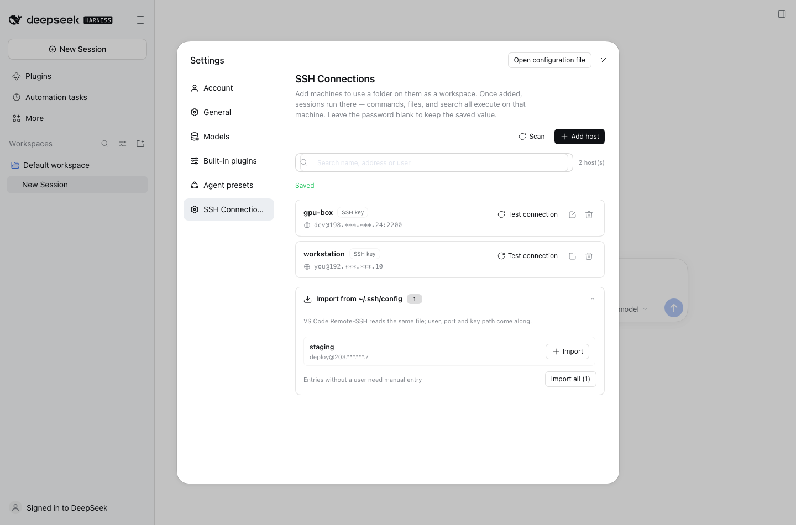
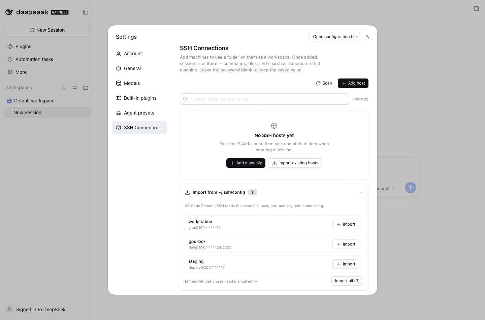

# DeepSeek Harness SSH Toolkit

[English](./README.md) · [中文](./README.zh.md)

Run DeepSeek Harness sessions on a remote machine over SSH. Pick any folder on
that machine as a workspace, and every shell / file / search tool call executes
there instead of on your laptop.

An independent, DSH 0.2-native continuation of
[dsh-ssh/dsh-ssh](https://github.com/dsh-ssh/dsh-ssh) — see
[CREDITS](./CREDITS.md). Not a mirror of upstream commits.



## Why this one

- **Works on current DSH (0.2.x).** Hosts live in a real storage domain, the
  client uses the 0.2 Typert + primitives contracts, and the settings page is
  built from the current component set.
- **Import the hosts you already have.** The scanner reads `~/.ssh/config`,
  `~/.ssh/config.d/*` and `Include` chains — the same file VS Code Remote-SSH
  uses — and imports user, port and key path in one click.
- **One package, no monorepo.** Host code, client bundle, tests and docs in a
  small, navigable tree.
- **Same-name tools, zero prompt surgery.** `bash`, `read`, `write`, `edit`,
  `read_image`, `glob` and `grep` keep their official names and arguments;
  routing depends only on the session's cwd.

## Features

| | |
|---|---|
| **Host manager** | Add, edit, test, remove hosts from Settings → SSH Connections. Password is write-only in the UI. |
| **Config import** | Scans `~/.ssh/config` (+ `config.d`, `Include`) and imports in bulk; entries without a `User` are flagged instead of silently broken. |
| **Seven routed tools** | `bash`, `read`, `write`, `edit`, `read_image`, `glob`, `grep` — same schemas, executed over SSH. |
| **Remote workspaces** | Browse a remote directory, pick it, get a local placeholder workspace; deleting the workspace cleans the placeholder up. |
| **Uploads** | Attaching a file in a remote workspace writes the bytes into the remote directory (collision-safe names) while keeping the message attachment card. |
| **UI parity** | The Files sidebar lists/previews the remote tree over SFTP, and the Terminal panel opens a remote shell (`ssh -tt`), reusing the official terminal for resize/scrollback. |
| **Background jobs** | `run_in_background` plus `job_list` / `job_output` / `job_kill` run on the remote host. |
| **Sandbox parity** | The three sandbox modes fence remote tool calls the same way they fence local ones. |
| **Trust on first use** | Unknown host keys show a fingerprint dialog; later connections verify `known_hosts`. |
| **Resilient transport** | Connection pool with reconnect, atomic remote writes, SFTP → `exec`+base64 fallback. |



## Requirements

| | |
|---|---|
| DSH | `0.2.1-rc.5` (desktop and web profiles) |
| Node | ≥ 22 |
| Remote OS | Linux or macOS (`sshd` only, no agent to install) |
| Auth | key (path or ssh-agent) or password |
| Topology | single hop (no ProxyJump) |

## Install

From a checkout:

```bash
git clone https://github.com/MaiwulanjiangMaiming/Deepseek-harness-SSH-toolkit.git
dsh plugin --profile desktop add ./Deepseek-harness-SSH-toolkit
```

or straight from GitHub:

```bash
dsh plugin --profile desktop add github:MaiwulanjiangMaiming/Deepseek-harness-SSH-toolkit
```

Use `--profile web` for a headless web setup. If pnpm reports
`ERR_PNPM_ADDING_TO_ROOT`, append `-w`. Then **fully restart DSH** and open
Settings → SSH Connections.

The plugin is additive: local workspaces behave exactly as before, and removing
it (`dsh plugin --profile desktop remove dsh-ssh-toolkit`) leaves DSH untouched.

## Quick start

1. Settings → SSH Connections → **Import from ~/.ssh/config** (or **Add host**).
2. Test the connection once; confirm the host key fingerprint on first use.
3. New session → pick the host → browse to a folder → it becomes the workspace.
4. Everything the agent runs now happens on that machine.

## How it works

```
index.js              host entry: sshPool service, hosts domain, routing hook
client.js             Settings page (settings.section slot, Typert client)
cordis.patch.yml      profile bundle row
src/hosts/            domain.js (schema + storage), model.js (merge/redact),
                      config-scan.js (~/.ssh/config importer)
src/ssh/              pool.js (ssh2 pool, TOFU, reconnect), exec-fs.js
src/tools/            tool registration + bash/fs/search implementations
src/remote/           Typert contract + host service (settings-page RPC)
src/workspace/        router.js (placeholder paths), placeholder.js
src/jobs.js           remote background jobs
src/policy.js         sandbox fence
src/compat/           UI bridge: remote Files sidebar + terminal
test/                 307 unit tests (node:test)
```

Hosts are stored as records in the `dsh_ssh_hosts` storage domain
(`~/.dsh/storages/dsh_ssh_hosts.json`). The settings page talks to the host over
a small Typert remote (`ssh/listHosts`, `saveHost`, `deleteHost`,
`testConnection`, `scanSshConfig`, plus the remote-workspace calls), so no
settings namespace is exposed to the wire.

## Notes and limits

- Passwords are stored **in plaintext** in `dsh_ssh_hosts.json` (same trade-off
  as upstream). Prefer keys; the private key itself is never copied.
- `ProxyJump` / multi-hop is not supported; such entries are listed but not
  imported.
- Remote `grep` uses GNU grep, so ignore rules differ slightly from `rg`.
- Windows remotes are not supported.
- The Files header still shows the local placeholder path (reads/writes go to the remote path); the terminal uses the local `ssh` client.
- Uploads write into the remote workspace; the attachment card still references the local staged copy for the model.

## Troubleshooting

**Connection test fails**
Check host, port and user; confirm `sshd` runs and the port is reachable. Keys must be `600` and
paths should avoid spaces. A desktop app launched from Finder may lack `SSH_AUTH_SOCK`; the plugin
then falls back to `~/.ssh/id_ed25519` → `id_ecdsa` → `id_rsa`. Set an explicit key path if neither
is available.

**Files sidebar stays on "Reading…"**
Confirm the plugin loaded with the profile (restart DSH), the directory exists and is readable.
The panel polls metadata every 3s, so a slow link takes a moment on first load.

**Terminal asks for a password or a host-key confirmation**
It is a plain local `ssh -tt`; OpenSSH handles auth. Key/agent auth does not prompt. The terminal's
`known_hosts` is the system one — separate from the plugin's TOFU dialog in Settings.

**Does opening a huge file download all of it?**
No. Text previews fetch the current page with a remote `awk` window (falling back to a 32 MB-capped
full read); image/PDF previews are bounded full reads.

**Where does an uploaded file go?**
Into the remote workspace root, with collision-safe names (`report (1).pdf`). A local staged copy is
kept for the model's attachment card. Uploads are buffered in memory and capped at 256 MiB.

## Development

```bash
pnpm install
pnpm test          # node --test test/*.test.js
pnpm selfcheck     # validates the client bundle + Typert descriptors
pnpm pack          # produces the publishable tarball
```

The client bundle is hand-authored (`client.js`) and mirrors the Typert
contract in `src/remote/contract.js`; `pnpm selfcheck` fails if the two drift.

## License

MIT — see [LICENSE](./LICENSE). Original work Copyright (c) 2026 dsh-ssh;
this continuation Copyright (c) 2026 Maiwulanjiang Maiming.
