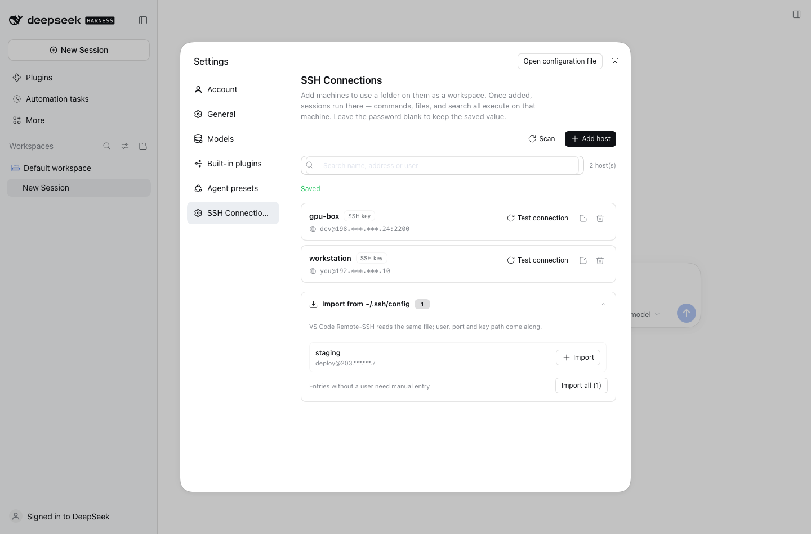
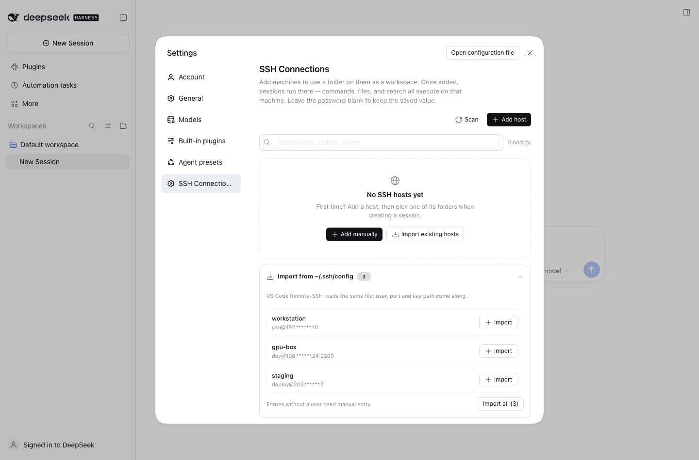

# DeepSeek Harness SSH Toolkit

[中文](./README.zh.md) · [English](./README.md)

通过 SSH 把 DeepSeek Harness 的工作区放到任意远端机器：在远端选一个目录作为工作区，
之后所有 shell / 文件 / 搜索工具调用都在那台机器上执行。

这是 [dsh-ssh/dsh-ssh](https://github.com/dsh-ssh/dsh-ssh) 的独立延续，面向 DSH 0.2.x
重写维护，不跟随上游提交（见 [CREDITS](./CREDITS.md)）。



## 为什么用这个

- **直接跑在现在的 DSH 上。** 主机存进 storage domain，客户端用 0.2 的 Typert 与
  primitives 契约，设置页按当前组件重做。
- **导入你已经有的主机。** 扫描 `~/.ssh/config`、`config.d/*` 和 `Include`
  （VS Code Remote-SSH 读的是同一份），用户、端口、密钥路径一并带过来。
- **单包结构。** 没有 monorepo，目录小、能一眼看完。
- **工具同名同参。** `bash`、`read`、`write`、`edit`、`read_image`、`glob`、`grep`
  保持官方名称和参数，路由只看会话 cwd。

## 功能

| | |
|---|---|
| **主机管理** | 设置页增删改、测试连接；口令在 UI 侧只写不回显。 |
| **配置导入** | 扫描 `~/.ssh/config`（含 `config.d`、`Include`）批量导入；缺 `User` 的条目会明确禁用而不是导进来跑不通。 |
| **七个工具远端执行** | `bash`、`read`、`write`、`edit`、`read_image`、`glob`、`grep`，schema 不变。 |
| **远端工作区** | 浏览远端目录并选为工作区；删除工作区时自动清理本地占位目录。 |
| **文件上传** | 在远端工作区里选文件上传，字节会直接写进远端目录（重名自动加序号），同时保留消息附件卡片。 |
| **界面一致** | 右侧栏 Files 通过 SFTP 读取远端目录/文件预览，Terminal 直接开远端 shell（`ssh -tt`），断线重连、resize、滚动都沿用官方终端实现。 |
| **后台任务远端化** | `run_in_background` 与 `job_list` / `job_output` / `job_kill` 整条链路在远端。 |
| **Sandbox 一致** | 三种 sandbox 模式对远端调用的拦截语义与本地一致。 |
| **首次信任（TOFU）** | 首次连接弹出指纹确认，之后按 `known_hosts` 校验。 |
| **健壮传输** | 连接池 + 断线重连、原子写入、SFTP 禁用时回退 `exec`+base64。 |



## 环境要求

| | |
|---|---|
| DSH | `0.2.1-rc.5`（desktop / web profile） |
| Node | ≥ 22 |
| 远端系统 | Linux 或 macOS（只需 `sshd`，无需装 agent） |
| 认证 | 密钥（路径或 ssh-agent）或口令 |
| 拓扑 | 单跳（不支持 ProxyJump） |

## 安装

从本地 checkout：

```bash
git clone https://github.com/MaiwulanjiangMaiming/Deepseek-harness-SSH-toolkit.git
dsh plugin --profile desktop add ./Deepseek-harness-SSH-toolkit
```

或直接从 GitHub：

```bash
dsh plugin --profile desktop add github:MaiwulanjiangMaiming/Deepseek-harness-SSH-toolkit
```

headless web 用 `--profile web`。若 pnpm 报 `ERR_PNPM_ADDING_TO_ROOT`，命令末尾加 `-w`。
安装后**完全退出并重启 DSH**，进入 设置 → SSH 连接。

插件是纯附加的：本地工作区行为不变；`dsh plugin --profile desktop remove dsh-ssh-toolkit`
即可完全移除。

## 快速上手

1. 设置 → SSH 连接 → **从 ~/.ssh/config 导入**（或**添加主机**）。
2. 测试连接；首次会要求确认主机指纹。
3. 新建会话 → 选主机 → 浏览远端目录 → 选为工作区。
4. 之后 agent 的所有命令都跑在那台机器上。

## 结构

```
index.js              host 入口：sshPool 服务、hosts 域、工具路由钩子
client.js             设置页（settings.section slot + Typert 客户端）
cordis.patch.yml      profile bundle 行
src/hosts/            domain.js（schema + 存储）、model.js（合并/脱敏）、
                      config-scan.js（~/.ssh/config 导入）
src/ssh/              pool.js（ssh2 连接池、TOFU、重连）、exec-fs.js
src/tools/            工具注册与 bash/fs/search 实现
src/remote/           Typert 契约 + host 服务（设置页 RPC）
src/workspace/        router.js（占位路径）、placeholder.js
src/jobs.js           远端后台任务
src/policy.js         sandbox 围栏
src/compat/           UI 桥接：右栏 Files / 终端
test/                 307 个单元测试（node:test）
```

主机以记录形式存于 `dsh_ssh_hosts` storage domain
（`~/.dsh/storages/dsh_ssh_hosts.json`）。设置页通过一组 Typert 方法访问宿主
（`ssh/listHosts`、`saveHost`、`deleteHost`、`testConnection`、`scanSshConfig`
以及远端工作区相关调用），不向 wire 暴露 settings namespace。

## 已知限制

- 口令**明文**存在 `dsh_ssh_hosts.json`（与上游相同取舍）；推荐用密钥，私钥本身不会被复制。
- 不支持 `ProxyJump` / 多跳；这类条目会列出但不会导入。
- 远端 `grep` 基于 GNU grep，忽略规则与 `rg` 略有差异。
- 不支持 Windows 远端。
- 文件面板顶部的路径仍显示本地占位目录（远端路径已用于实际读写）；终端依赖本机 `ssh` 客户端。
- 上传会写入远端工作区；消息附件卡片仍然引用本地暂存副本供模型使用。

## 常见问题

**测试连接失败 / 连不上主机**
检查 host、port、user；确认远端 `sshd` 在跑、22 端口可达。密钥认证要求私钥权限 `600`，
路径不要带空格或中文。桌面版从 Finder 启动时可能没有 `SSH_AUTH_SOCK`，插件会回退到
`~/.ssh/id_ed25519` → `id_ecdsa` → `id_rsa`；都没有时请在主机配置里显式填私钥路径。

**Files 侧栏一直显示 Reading…**
确认插件已随 profile 加载（重启 DSH）、远端目录存在且当前用户可读。侧栏每 3 秒轮询一次
元数据，网络很慢时首次加载会稍久。

**终端里提示输入密码或确认主机指纹**
终端就是本机的 `ssh -tt`，按 OpenSSH 的正常流程走；密钥/agent 认证不会弹密码。
主机指纹的 `known_hosts` 与插件设置页的 TOFU 对话框是两套（终端用系统默认）。

**打开大文件会不会整份下载？**
不会。文本预览走远端 `awk` 只取当前页（失败时回退到受 32MB 上限约束的整读）；
图片/PDF 预览仍是受上限的整读。

**上传的文件在哪？**
写进远端工作区根目录，重名自动变成 `report (1).pdf`；消息附件卡片同时保留一份本地暂存
副本给模型使用。单次上传上限 256 MiB（当前在内存中缓冲）。

**其它机器/CI 上能用吗？**
CI 只跑单测与打包。运行需要 DSH 0.2.1-rc.5 + Node 22；远端仅需 `sshd`，不需要安装任何 agent。

## 开发

```bash
pnpm install
pnpm test          # node --test test/*.test.js
pnpm selfcheck     # 校验 client bundle 与 Typert 描述符
pnpm pack          # 产出可发布 tarball
```

## License

MIT，见 [LICENSE](./LICENSE)。原始工作 Copyright (c) 2026 dsh-ssh；
本延续项目 Copyright (c) 2026 Maiwulanjiang Maiming。
